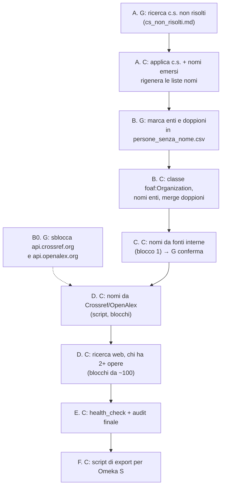

# Piano di lavoro – dopo la chiusura del journal (21/10/2026)

Spuntare con `[x]` man mano. **G** = Giacomo, **C** = Claude.
Regola: i CSV si toccano solo tramite gli script; una persona alla volta su `persons.csv`.

## A. Citazioni "c.s."
- [x] G – ricerca dei c.s. in `output/cs_non_risolti.md` (annotare anche i nomi di persona trovati)
- [x] C – applica i c.s. risolti (`resolve.py set`: data, contenitore, pagine; tag `cs-resolved`)
- [x] C – applica i nomi di persona emersi
- [x] C – rigenera `persone_senza_nome.csv` e `persone_solo_iniziali.csv` (`scripts/missing_names_list.py`)

## B. Enti e persone
- [x] G – sblocca i domini `api.crossref.org` e `api.openalex.org` (claude.ai → Settings → Capabilities) — serve solo per D
- [x] G – in `persone_senza_nome.csv`: `ente` nelle note (+ nome per esteso se serve), doppioni come `= P00xxxx`
- [x] C – enti nascosti in persone_solo_iniziali (praticamente nessuno)
- [x] C – colonna di classe in `persons.csv` (`foaf:Person` / `foaf:Organization`) via script
- [x] C – applica nomi degli enti, merge dei doppioni, drop-orphans, audit

## C. Nomi propri da fonti interne (blocco 1)
- [x] C – proposte da omonimi, varianti di cognome e cognomi doppi (`output/nomi_proposti_blocco_1.csv`, 78 righe)
- [x] G – conferma il blocco (delega a Claude, 22/10/2026)
- [x] C – applica, `audit_duplicates.py` (22/10/2026: 74 merge-person, 1 merge-work, 3 nomi, 0 nuovi doppioni certain/probable)

## D. Nomi propri da fonti esterne
Regola di fiducia: diretto solo con fonte autorevole sulla stessa opera (Crossref, OpenAlex,
editore, ORCID) e nome compatibile con tutte le iniziali; il resto va nel report di blocco.
Ogni blocco: `output/nomi_proposti_blocco_N.csv` (ID, forma citata, nome proposto, fonte, fiducia).
- [x] C – script Crossref/OpenAlex (`scripts/fetch_names_api.py`), chiuso 22/10/2026: per DOI 276 nomi (`nomi_proposti_blocco_2.csv`; 19 persone poi separate perché riunivano più persone), per titolo Crossref 177 nomi (elenco nel decisions.log), OpenAlex 54 + 35 nomi (`nomi_proposti_blocco_3.csv`, `_4.csv`); dubbi "media" lasciati alla ricerca web
- [ ] C – ricerca web, persone con 2+ opere (~1.600, blocchi da ~100)
  - blocco 5 (22/10/2026, `nomi_proposti_blocco_5.csv`): 100 persone con più opere → 49 nomi + 2 correzioni di dati, 4 opere separate da persone che ne riunivano più d'una, 23 persone da separare (report), 22 non trovate; restano 583 persone con 2+ opere
  - blocco 6 (22/10/2026, `nomi_proposti_blocco_6.csv`): 98 persone → 52 nomi, 17 da separare (report), 28 non trovate, 1 media
  - blocco 7 (22/10/2026, `nomi_proposti_blocco_7.csv`): 100 persone → 39 nomi, 25 da separare (report), 36 non trovate; in tutto 11 separazioni fatte nei blocchi 6–7
  - blocco 8 (22/10/2026, `nomi_proposti_blocco_8.csv`): cognomi A–G (+ altri) → 59 nomi, 14 separazioni (P022695–P022708), 5 unioni con persone già complete (Bernal Casasola, Drago Troccoli, Bonacasa Carra, Beloch, Dimbleby), 2 cognomi corretti (van Donzel, Jiménez Fernández-Palacios); iniziali di Ferriès/Delrieux erano scambiate
  - blocco 9 (22/10/2026, `nomi_proposti_blocco_9.csv`): cognomi G–L → 33 nomi, 8 separazioni (P022709–P022716), 3 unioni (Grau Almero, Knapp, Melero), 2 cognomi corretti (Lüdtke, Hargreaves)
  - blocco 10 (22/10/2026, `nomi_proposti_blocco_10.csv`): cognomi M–Z → 74 nomi, 22 separazioni (P022717–P022738), 2 unioni emerse dall'audit (Andy Clark, Heizer); ricerca web sulle persone con 2+ opere conclusa
  - colonna `name_note` in persons.csv (22/10/2026): nota "nome attribuito in automatico, può contenere errori" su tutti i nomi della fase D (non sui nomi Zotero, per decisione); applicati con la nota anche i 104 casi a fiducia media (`nomi_proposti_medie.csv`)
  - persone con una sola opera (fiducia bassa accettata): ricerca per titolo Crossref → 403 nomi (`nomi_proposti_singole_crossref.csv`), OpenAlex → 120 nomi (`nomi_proposti_singole_openalex.csv`); 32 cognomi corretti, 9 unioni; restano 354 opere da cercare su OpenAlex (credito delle chiavi esaurito il 22/10), poi ricerca web
  - nomi dal record OpenAlex del DOI (chiamata gratuita, anche per i DOI trovati per titolo su Crossref) → 267 nomi (`nomi_proposti_singole_oa_doi.csv`), 5 cognomi corretti
- [ ] G – controllo a campione di ogni blocco
- [ ] C – dopo ogni blocco: `audit_duplicates.py` (i nomi pieni fanno emergere doppioni)
- [ ] G – decidere se fermarsi o proseguire con chi ha una sola opera (~5.300)

## E. Controllo finale
- [x] C – `scripts/health_check.py` + `audit_duplicates.py` + controlli aggiuntivi (22/10/2026): struttura CSV, codifica, `|` nei campi singoli, DOI condivisi, persone ripetute nella stessa opera, persone con opere a secoli di distanza. Corretti: 9 coautori omonimi riuniti in una persona (Castiglioni Al./An., Zhang L./L., ecc.), 31 persone separate perché univano persone diverse (Alberti L.B. 1443, Stein A. 1921, Lézine 1967, Pesce G. 1936…), 4 unioni di persone (Martínez Navarrete, Gifford-Gonzalez, Holdaway, Delpozzo), 2 unioni di opere con lo stesso DOI, 15 nomi ripuliti (2 enti, "et al." nel nome, minuscole); tutto nel decisions.log con `[auto] … controllo finale`
- [x] C/G – `|` nel titolo di W017374 corretto; citazione doppia art. 428 pos. 5 (Valdés voll. 1-2 sullo stesso record) lasciata: la risolve la deduplica citante→citato dell'export
- [ ] G – supplementi 1–15 (0 di 289 elaborati): decidere se elaborarli prima dell'export o importare ora solo il journal
- [ ] G – 20 c.s. dei vol. 35–37 aggiunti a `cs_non_risolti.md` (ora 39)

## F. Export per Omeka S
- [ ] C – script di export: persone/enti → opere → citazioni (`bibo:cites`), dedup coppie citante→citato
- [ ] G – import di prova su BiDiAr
